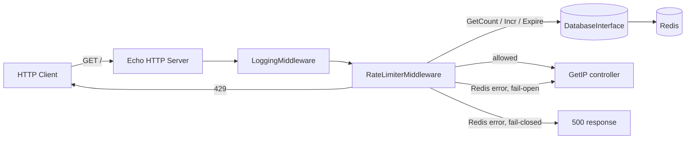
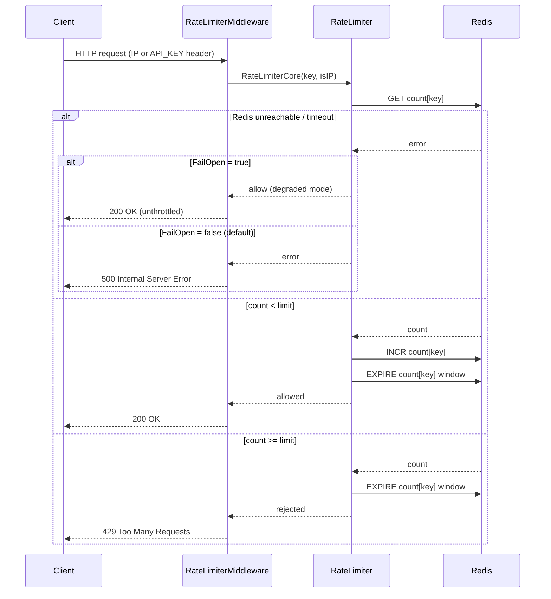

# High-Throughput Redis Rate Limiter in Go

A rate limiter middleware for Go web services, backed by Redis. It throttles
incoming HTTP requests by client IP or by an API token, with per-token
override of the limit/window, and is designed so the storage backend
(currently Redis) can be swapped out behind a small interface.

Built with [Echo](https://echo.labstack.com/) as the HTTP framework and
[go-redis](https://github.com/redis/go-redis) as the Redis client.

## Features

- Per-IP and per-token rate limiting, configured via environment variables.
- Token-based limits take precedence over IP-based limits (e.g. IP capped at
  10 req/s, but a specific `API_KEY` can be configured for 100 req/s).
- Storage is abstracted behind `database.DatabaseInterface`
  (`internal/database/database.go`), so Redis can be replaced with another
  store without touching the rate-limiting logic.
- Rate-limiting logic (`internal/web/middleware/rate_limiter.go`) is fully
  decoupled from the Echo middleware wiring, and is unit-tested with a mock
  store (no network dependency).
- Configurable fail-open / fail-closed behavior when Redis is unreachable
  (see "Tradeoff Analysis" below).
- Returns HTTP 429 with a clear message when a limit is exceeded, HTTP 200
  otherwise.

## Architecture

### Component overview



`DatabaseInterface` is the seam that lets the Redis implementation
(`internal/database/redisdb`) be swapped for another store (e.g. in-memory,
Memcached) without changing `RateLimiter` or the middleware.

### Request sequence (fixed-window counter)



Each request costs one `GET` plus either one `INCR`+`EXPIRE` pair (allowed)
or one `EXPIRE` (rejected) round-trip to Redis — this cost is the main driver
of the throughput numbers below.

## Configuration

Set via environment variables or a `.env` file in `cmd/app/`:

| Variable       | Description                                                         |
|----------------|-----------------------------------------------------------------------|
| `IP_LIMIT`     | Max requests per window for a client IP                              |
| `IP_DURATION`  | Window size for IP-based limiting (e.g. `1s`, `5m`)                  |
| `API_KEY`      | The token value that gets its own limit (sent via `API_KEY` header)  |
| `API_LIMIT`    | Max requests per window for that token                               |
| `API_DURATION` | Window size for token-based limiting                                 |
| `REDIS_ADDR`   | Redis address, e.g. `redis:6379` in Docker, `localhost:6379` locally |
| `FAIL_OPEN`    | `true`/`false`. See "Fail-open vs fail-closed" below. Default: `false` (fail-closed) |

## Running it

```sh
docker compose up -d --build
curl http://localhost:8080/
curl -H "API_KEY: api-key-1" http://localhost:8080/
```

The server listens on port 8080. `rate-limit.http` has example requests for
the VS Code REST Client extension or Postman.

## Testing

```sh
go test ./...
```

Unit tests cover the rate-limit core logic (allow/deny decisions,
expiration updates) and both the fail-open and fail-closed middleware paths,
using a mocked store — no Redis dependency required.

## Benchmarks and Tradeoff Analysis

Numbers below were measured locally (Apple M1, Docker via Colima VM) against
the real Redis container from `docker-compose.yaml` — not synthetic or
estimated. Reproduce with the commands shown; expect different absolute
numbers on bare-metal Linux or against a managed Redis (lower latency, no
VM-network overhead), but the same relative shape (dominant cost = Redis
round-trips, not Go/Echo overhead).

### Core logic benchmark (`go test -bench`)

Exercises `RateLimiterCore` directly against Redis (GET + INCR + EXPIRE per
call), bypassing HTTP entirely, to isolate the storage round-trip cost:

```sh
docker compose up -d redis
REDIS_ADDR=localhost:6379 go test ./internal/web/middleware/... \
  -run=^$ -bench=. -benchtime=3s -benchmem -cpu=1,32,128
```

| Benchmark                              | Concurrency | ns/op   | Implied ops/sec |
|-----------------------------------------|:-----------:|--------:|-----------------:|
| `BenchmarkRateLimiterCore_Allowed`      | 1           | ~1.1 ms | ~900             |
| `BenchmarkRateLimiterCore_Rejected`     | 1           | ~1.2 ms | ~850             |
| `BenchmarkRateLimiterCore_Parallel`     | 32          | ~96 µs  | ~13,300          |
| `BenchmarkRateLimiterCore_Parallel`     | 128         | ~76 µs  | ~16,900          |

At concurrency 1, each call pays the full loopback round-trip latency
(~0.5–0.6 ms per Redis command through Docker Desktop/Colima's VM network
layer). Throughput scales close to linearly with concurrency until the
local Redis connection pool / OS socket limits become the bottleneck — on
this machine, pushing past ~128 concurrent connections through the Colima
VM's port forwarder started refusing connections. On a bare-metal Linux host
talking to Redis over a unix socket or a dedicated NIC, both the per-call
latency and the practical concurrency ceiling would be meaningfully better.

### End-to-end HTTP load test (`hey`)

Exercises the full stack: Echo → LoggingMiddleware → RateLimiterMiddleware →
Redis, with the per-IP limit temporarily raised so the run measures
sustained throughput rather than 429 handling:

```sh
docker compose up -d --build   # IP_LIMIT/IP_DURATION raised for this run only
hey -z 15s -c 100 http://localhost:8080/
```

Result (15s run, 100 concurrent connections, 259,923 requests, all 200 OK):

- **Throughput: ~17,300 req/sec sustained**
- **Latency: p50 5.4 ms, p90 8.6 ms, p99 12.6 ms**

Throughput plateaued around 100–200 concurrent connections (17.3k req/sec at
c=100 vs 17.0k req/sec at c=200); beyond that, added concurrency increased
latency without increasing throughput, indicating the Redis round-trip
(not Echo or the Go runtime) is the bottleneck, consistent with the core
benchmark above.

### Tradeoff: Fixed Window Counter vs. Token Bucket vs. Sliding Window

This implementation uses a **fixed window counter** (Redis `INCR` + `EXPIRE`
per key): each key gets a hard counter that resets only when its TTL
expires.

| Algorithm              | Pros                                                              | Cons                                                                      |
|-------------------------|--------------------------------------------------------------------|----------------------------------------------------------------------------|
| Fixed window (used here)| O(1), 2 Redis ops/request, trivial to reason about and implement   | Allows up to 2x the configured limit in bursts straddling a window edge   |
| Sliding window (log/counter hybrid) | Smooths out the edge-burst problem, more accurate limiting | More Redis ops or a Lua script per request; more memory (log) or more complex counters |
| Token bucket            | Naturally allows controlled bursts while enforcing an average rate | Needs atomic read-modify-write of bucket state (Lua script or `redis.Client.Watch`), slightly more complex to implement correctly under concurrency |

Fixed window was chosen here for simplicity and because the cost is
dominated by Redis round-trips rather than CPU — the benchmark above shows a
single `INCR`+`EXPIRE` pair already costs ~0.5-1ms locally, so an algorithm
needing 3-4 Redis ops per request (e.g. a sliding-window log) would roughly
halve throughput for a marginal accuracy gain at these request rates. A
token bucket implemented via a Lua script (single round-trip, atomic) would
be the natural next step if burst smoothing becomes a requirement.

### Tradeoff: Fail-open vs. fail-closed on Redis failure

Controlled by `FAIL_OPEN` (default `false`, i.e. fail-closed). See the
sequence diagram above. Verified by stopping Redis mid-run:

```sh
docker compose stop redis
curl -i http://localhost:8080/   # -> 500 Internal Server Error (fail-closed)
docker compose start redis
curl -i http://localhost:8080/   # -> 200 OK, recovers immediately
```

| Strategy | Behavior when Redis is unreachable | When to use |
|---|---|---|
| Fail-closed (default) | Reject the request with 500 | Rate limiting is a hard requirement (e.g. protecting a fragile downstream from overload); a short outage of the limiter should not let unbounded traffic through |
| Fail-open (`FAIL_OPEN=true`) | Let the request through unthrottled, log the error | Availability of the protected service matters more than strict enforcement; a brief Redis blip shouldn't take down the whole API |

Both paths are covered by
`TestRateLimiterMiddleware_FailClosed_Returns500` and
`TestRateLimiterMiddleware_FailOpen_PassesThrough` in
`internal/web/middleware/rate_limiter_test.go`.

## Project layout

```
cmd/app/                         entrypoint, env/config wiring
internal/database/               DatabaseInterface + Redis implementation
internal/web/middleware/         rate limiter core logic + Echo middleware + logging
internal/web/controller/         sample handler used to exercise the limiter
```
